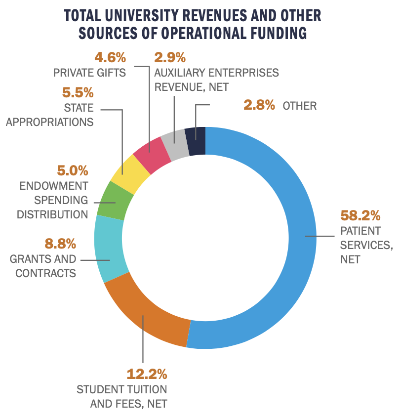
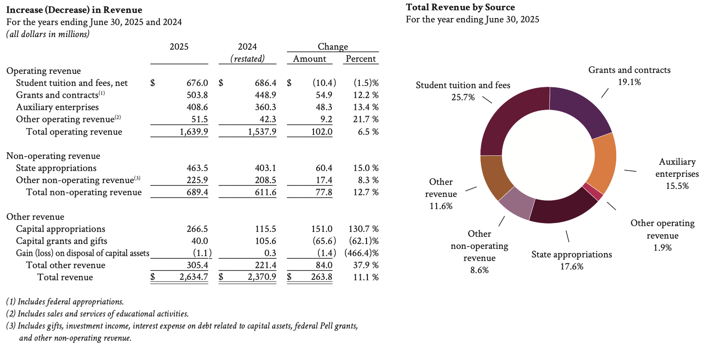
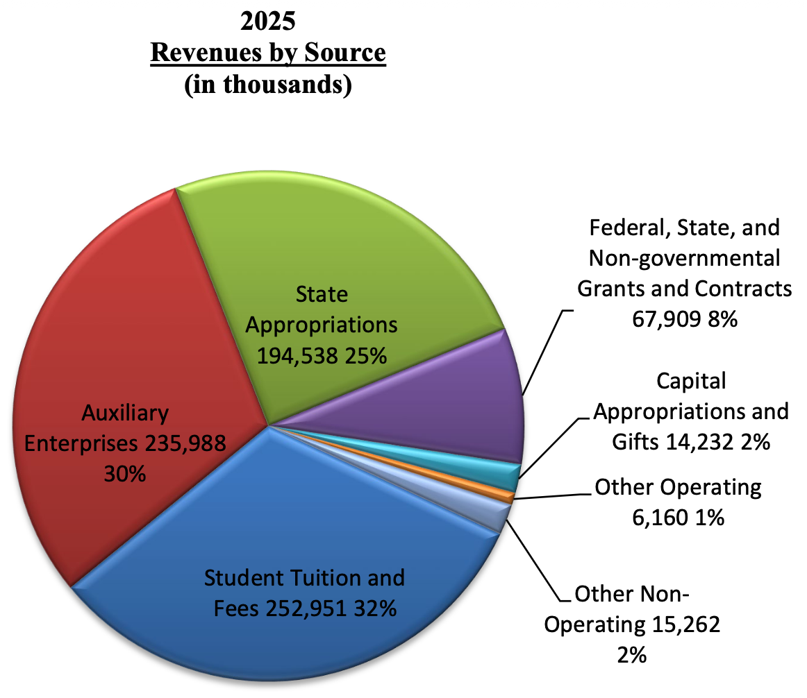

# JMU Finances

## JMU vs. R1 Revenues

Here are the operating revenues of 3 Virginia Universities:

- R1:
    - [UVA](./annual_reports/2025.12_FY25_UVA_AnnFinRpt_mb_jm_FINAL_Appligent_508.pdf)
    - [VT](./annual_reports/FY25_Final_Financial_Report_web.pdf)
- R2: [JMU](./annual_reports/2E106477-8D9B-4876-ADB7-477B93781CA9.pdf)
    - look at that filename?! 🤢 `2E106477-8D9B-4876-ADB7-477B93781CA9.pdf`

Specifically, look at these:

### UVA Revenues 2024-2025

### VT Revenues 2024-2025

### JMU Revenues 2024-2025

If I understand these well, it looks like at all 3 universities, student tuition is a larger percentage of the revenue than grants and contracts.
At JMU, the percentage of revenue from student tuition is highest, but is still only 32% of our revenue.
At the other universities, the tuition is (also) a higher percentage of revenue than grants and contracts.

However at JMU, many of the faculty chose to work here to focus on teaching our undergraduate students.
For me personally, this is important because I think too few families even know there is a Research <-- > Teaching Continuum of Universities and what a school's position in that continuum means about the administration's and faculties' priorities.

It is exploitative to fund the university more on student tuition than on grants, but to prioritize research over teaching.

## How much does a JMU student pay toward athletics?

**Short answer: about $3,000+ per year, roughly half of the comprehensive fee.**
For FY 2027 (2026-27) JMU itself reports an Intercollegiate Athletics SCHEV program fee of **$3,172** per full-time undergraduate, out of a **$6,222** comprehensive fee (51%).
Every full-time undergraduate pays it; it's the same in-state or out-of-state.

### Three views of the same number

1. **Line item only**: the FY24 comprehensive fee breakdown ([data/jmu-fees-fy24.json](./data/jmu-fees-fy24.json), from [The Breeze](https://www.breezejmu.org/news/over-900-for-debt-444-for-urec-exclusive-breakdown-of-student-fees/article_b98cc294-0f44-11ef-a311-c75b454e3750.html)) lists Intercollegiate Athletics at **$2,361.72** of $5,614.07 (42%): $1,798.27 for operations plus $563.45 for athletics debt service.
2. **Adding athletic facilities**: several items listed under "Facilities" are also athletics:

    | Item | $/student/yr |
    | --- | ---: |
    | Intercollegiate Athletics (ops + debt) | 2,361.72 |
    | Atlantic Union Bank Center | 91.43 |
    | Convocation Center | 70.91 |
    | Bridgeforth Stadium | 63.54 |
    | Plecker Athletic Performance Center | 22.96 |
    | **Subtotal** | **2,610.56 (46.5%)** |
    | Godwin Hall (mixed use) | 38.13 |
    | Marching Royal Dukes (mixed use) | 55.95 |
    | **With mixed use** | **2,704.64 (48.2%)** |

    "Debt Service – Other" ($379.84) probably also covers some athletics buildings, so treat these totals as a lower bound.
3. **All athletics spending (JMU/SCHEV)**: JMU's [rates breakdown page](https://www.jmu.edu/ubo/student-accounts/rates-breakdown.shtml) shows athletics at $2,581 in the pie chart for FY27. Below the chart it adds: *"Intercollegiate Athletics SCHEV program fee, as reported on SCHEV E-1, is $3,172. This figure represents an allocation of the comprehensive fee based on all program expenditures for Athletics."*

### Cross-check with the audited reports

- The FY25 NCAA report ([athletics/ncaa_reports/JMU_NCAA_FY25.pdf](./athletics/ncaa_reports/JMU_NCAA_FY25.pdf)) shows **$58.1M** of student fees going to athletics.
- The FY25 audited financial report (Note 14) shows **$113.7M** of comprehensive fee revenue before $19.2M of scholarship allowances.
- $58.1M ÷ $113.7M = **51%**. This matches JMU's $3,172 ÷ $6,222.

### Student fees vs. the whole athletics budget (NCAA reports)

The NCAA reports are filed through the [Virginia Auditor of Public Accounts](https://www.apa.virginia.gov/reports/23525) and stored in [athletics/ncaa_reports/](./athletics/ncaa_reports/).

| Fiscal year | Student fees | Total athletics operating revenue | Share from students |
| --- | ---: | ---: | ---: |
| FY15 | $35,287,957 | $44,825,701 | 79% |
| FY18 | $38,932,918 | $51,719,402 | 75% |
| FY19 | $41,576,716 | $52,704,654 | 79% |
| FY21 | $46,129,126 | $52,865,352 | 87% (COVID, almost no ticket sales) |
| FY23 | $53,285,977 | $68,035,339 | 78% |
| FY24 | $55,528,882 | $76,382,639 | 73% |
| FY25 | $58,144,880 | $78,640,115 | 74% |

Student fees going to athletics rose **65%** from FY15 to FY25.
The reports' notes explain how the amount is set: student fees are *"allocated to cover any overall Athletics operating deficit."*
In other words, students pay whatever ticket sales, donations, NCAA and conference money don't cover.

### FY25 for scale:

- Other revenue: tickets $4.9M, contributions $5.9M, NCAA distributions $1.3M, sponsorships $1.8M, and only $2.2M of direct institutional support.
- Athletic facility debt service: $10.3M.
- *"Indirect cost paid to the institution by Athletics"*: $5.6M. This is overhead that flows back to JMU, and students fund about 74% of athletics.

### Compared with the rest of Virginia (Knight Commission / Cardinal News)

These figures come from the [Knight-Newhouse College Athletics Database](https://knightnewhousedata.org/), the Knight Commission's successor to CAFI, as reported by Cardinal News:

- JMU raises more money from mandatory student fees for athletics than **any other school in the nation**.
- JMU's 2025-26 athletics fee was $3,036 per student. The Virginia average was $1,967, UVA charged $823 and VT charged $832.
- Athletic fees are the fastest-rising part of the cost of attending a Virginia public college: up 5.5% in the last year.

### Cardinal News articles:

- [James Madison University generates more money from mandatory student fees for athletics than any other school in the nation](https://cardinalnews.org/2025/12/18/james-madison-university-generates-more-money-from-mandatory-student-fees-for-athletics-than-any-other-school-in-the-nation/) (2025-12-18)
- [James Madison University stands out in College Football Playoff field. Its mandatory student fee for athletics is more than 4 times higher than all the other schools put together.](https://cardinalnews.org/2025/12/15/james-madison-university-stands-out-in-college-football-playoff-field-it-has-the-highest-mandatory-student-fee-for-athletics-by-far/) (2025-12-15)
- [Mandatory fees for intercollegiate athletics are the fastest-rising part of cost of attending a state college in Virginia](https://cardinalnews.org/2026/08/07/mandatory-fees-for-intercollegiate-athletics-are-the-fastest-rising-part-of-cost-of-attending-a-state-college-in-virginia/) (2026-08-07)
- [Some students are incurring debt so that fellow students can play sports that they're now getting paid for](https://cardinalnews.org/2026/09/25/some-students-are-incurring-debt-so-that-fellow-students-can-play-sports-that-theyre-now-getting-paid-for/) (2026-09-25)
- [James Madison University jumps to a different athletic conference. Here's the political question that's not being asked.](https://cardinalnews.org/2026/10/13/james-madison-university-jumps-to-a-different-athletic-conference-heres-the-political-question-thats-not-being-asked/) (2026-10-13)
- [Deeds proposal would allow Virginia Tech and UVa to raise more athletics money from student fees](https://cardinalnews.org/2026/02/10/deeds-proposal-would-allow-some-of-virginias-top-football-colleges-to-raise-more-money-from-student-fees/) (2026-02-10)
- [Former college president: Why must students be forced to subsidize college sports? Rising mandatory fees should get attention.](https://cardinalnews.org/2025/11/19/former-college-president-why-must-students-be-forced-to-subsidize-college-sports-rising-mandatory-fees-should-get-attention/) (2025-11-19)
- [Students are forced to subsidize college sports. Why?](https://cardinalnews.org/2024/03/27/students-are-forced-to-subsidize-college-sports-why/) (2024-03-27)
- [Should students have to pay fees to support intercollegiate sports? Here's what readers have to say.](https://cardinalnews.org/2026/01/02/should-students-have-to-pay-fees-to-support-intercollegiate-sports-heres-what-readers-have-to-say/) (2026-01-02)
- [Researcher: Addressing runaway college sports spending in Virginia](https://cardinalnews.org/2026/03/20/researcher-addressing-runaway-college-sports-spending-in-virginia/) (2026-03-20)

### Other references (from [jmu-finances-infovis](https://github.com/hcientist/jmu-finances-infovis))

- [Undergraduate student estimated annual costs](https://www.jmu.edu/ubo/tuition-and-fees/examples.shtml)
- [JMU FY23 financial statements](./annual_reports/JMU_FY23_Financial_Statements.pdf) ([source](https://dlas-directus-prod.azurewebsites.net/assets/D483491A-F567-42B7-B936-17D1ACF64E9A.pdf))
- [JMU FY23 athletics (NCAA) financials](./athletics/ncaa_reports/JMU_NCAA_FY23.pdf) ([source](https://dlas-directus-prod.azurewebsites.net/assets/F1F30B26-FCE4-45EE-9222-50D42E8A5C7A.pdf))
- [Comprehensive fee breakdown](https://www.jmu.edu/ubo/student-accounts/rates-breakdown.shtml)
- [The Breeze: Over $900 for debt, $444 for UREC: exclusive breakdown of student fees](https://www.breezejmu.org/news/over-900-for-debt-444-for-urec-exclusive-breakdown-of-student-fees/article_b98cc294-0f44-11ef-a311-c75b454e3750.html) and its [FY24 expenditure breakdown PDF](https://bloximages.newyork1.vip.townnews.com/breezejmu.org/content/tncms/assets/v3/editorial/b/a5/ba5940ac-0f4a-11ef-aa66-eb7bb38401ee/663eed2533491.pdf.pdf)
